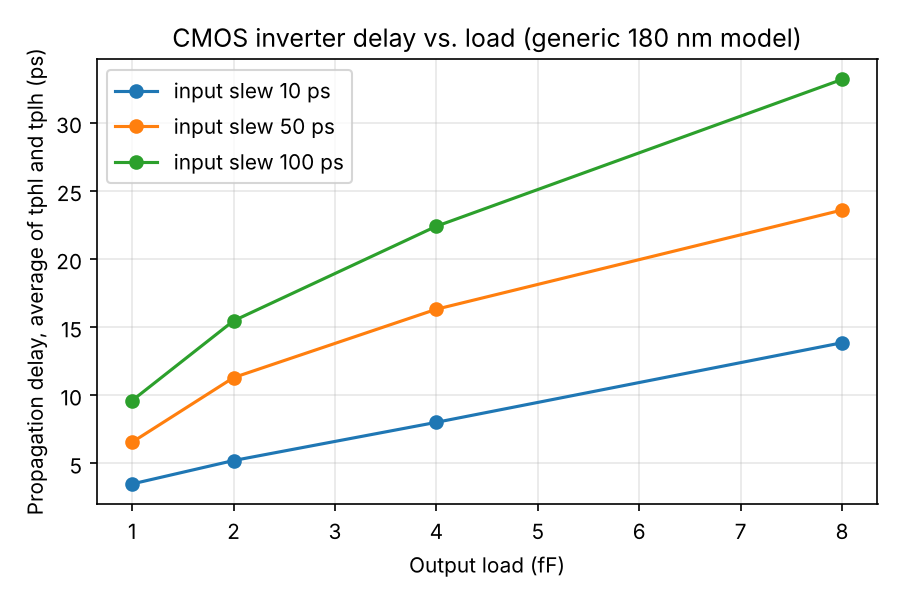

# CMOS Inverter Delay and Leakage Characterization

A small ngspice + Python flow that characterizes a CMOS inverter, in the spirit of
standard-cell library characterization. It sweeps input slew and output load, measures
propagation delay and static leakage, and writes the results as a CSV table and plot.

## What it does

1. Fills a SPICE netlist template with the slew and load for each point.
2. Runs ngspice in batch mode and reads the `.meas` results from the log.
3. Writes `results/delay_table.csv` and `results/delay_vs_load.png`.

## Setup

```bash
sudo apt install ngspice        # or your distro's equivalent
pip install -r requirements.txt
```

## Usage

```bash
python src/run_delay.py --cload 4 --slew 50     # one delay point
python src/run_leakage.py                       # leakage, input low and high
python src/characterize.py                      # full sweep -> results/delay_table.csv
python src/plot_results.py                      # -> results/delay_vs_load.png
python -m unittest discover tests               # parsing tests (no ngspice needed)
```

## Method

- **Circuit:** one CMOS inverter, 0.18 µm-class sizing (NMOS W = 1 µm, PMOS W = 2 µm, L = 0.18 µm), VDD = 1.8 V.
- **Delay:** 50% crossings. `tphl` is input rising to output falling; `tplh` is input falling to output rising.
- **Sweep:** loads of 1, 2, 4, and 8 fF; input slews of 10, 50, and 100 ps.
- **Leakage:** average supply current from 5 ns to 10 ns with the input held low or high, converted to power as |I| × VDD.

## Results



Delay rises with both load and input slew. `tphl` and `tplh` match because the PMOS
is sized so that its drive strength equals the NMOS's.

## Limitations

- **Generic Level-1 models.** They are a teaching approximation, not a foundry model.
  Absolute delays are not comparable to a real library.
- **Leakage is not meaningful yet.** Level-1 models have no subthreshold conduction,
  so the leakage value is close to simulator noise and identical for both input states.
  A realistic leakage number needs a BSIM model with subthreshold behavior.
- **No Liberty output.** The results are a CSV table, not a `.lib` file.
- **One cell, one corner.** Only an inverter at 1.8 V, typical settings. No PVT sweep.

## Possible next steps

- Swap in a BSIM model (for example, the open-source sky130 PDK) to get realistic leakage.
- Add a NAND2 cell and write the tables in Liberty format.
- Sweep supply voltage or temperature to add PVT corners.
